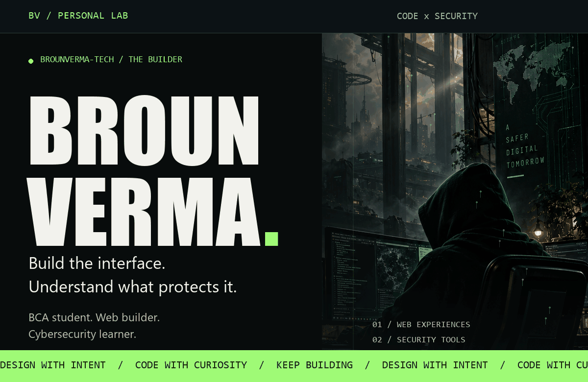

<picture>
  <source media="(prefers-reduced-motion: reduce) and (max-width: 600px)" srcset="./assets/code-security/hero-mobile-still.png">
  <source media="(prefers-reduced-motion: reduce)" srcset="./assets/code-security/hero-still.png">
  <source media="(max-width: 600px)" srcset="./assets/code-security/hero-mobile.gif">
  
</picture>

  <a href="https://brounstack.in/"><b>Explore BrounStack ↗</b></a> &nbsp; / &nbsp;
  <a href="https://www.indelvia.com/"><b>Indelvia ↗</b></a> &nbsp; / &nbsp;
  <a href="https://www.linkedin.com/in/broun-v-a399332a9"><b>Let's connect ↗</b></a>

# Two worlds. One mindset.

I'm **Broun Verma** — a recruitment professional pursuing a **Bachelor of Computer Applications**, building for the web and exploring how systems work and how to protect them.

My work connects two interests: **thoughtful web experiences** and **practical security tools**. I learn by building, investigating, and improving one project at a time.

<picture>
  <source media="(prefers-reduced-motion: reduce) and (max-width: 600px)" srcset="./assets/code-security/code-interface-mobile-still.svg">
  <source media="(prefers-reduced-motion: reduce)" srcset="./assets/code-security/code-interface-still.svg">
  <source media="(max-width: 600px)" srcset="./assets/code-security/code-interface-mobile.svg">
  
</picture>

## 01 / Security, through building.

### [Security Log File Analyzer ↗](https://github.com/brounverma-tech/log-file-analyzer)

Explore authentication logs, count activity by IP address, and flag repeated failed login attempts.

`Python` · `Log analysis` · `Security monitoring`

### [File Integrity Checker ↗](https://github.com/brounverma-tech/file-integrity-checker)

Detect file modifications by comparing SHA-256 hashes against a saved baseline.

`Python` · `SHA-256` · `JSON`

### [Network Port Scanner ↗](https://github.com/brounverma-tech/network-port-scanner)

Understand TCP connections by discovering open ports on localhost in a learning environment.

`Python` · `Sockets` · `TCP/IP`

**More from the lab:** [Password Strength Checker](https://github.com/brounverma-tech/password-strength-checker) · [Secure Password Generator](https://github.com/brounverma-tech/secure-password-generator) · [Linux Security Audit Tool](https://github.com/brounverma-tech/linux-security-audit-tool)

## 02 / The web side.

### [BrounStack ↗](https://brounstack.in/)

My programming, technology, and learning platform — a place to build and share what I learn.

### [Indelvia ↗](https://www.indelvia.com/)

A professional business website built around a modern web experience.

### [Modern Calculator ↗](https://github.com/brounverma-tech/modern-calculator)

A responsive calculator built with HTML, CSS, and JavaScript. **[Try the live demo ↗](https://brounverma-tech.github.io/modern-calculator/)**

## 03 / The everyday toolkit.

**Web** &nbsp; HTML · CSS · JavaScript · TypeScript · React · Next.js  
**Programming** &nbsp; Python · C  
**Systems & tools** &nbsp; Linux · Git · GitHub · VS Code

### Currently exploring

- Linux fundamentals, networking, and cybersecurity.
- React, Next.js, TypeScript, and better web experiences.
- Python automation, log analysis, and security tooling.

<b>Explore more of my learning journey</b>

#### C programming

[Student Grade Calculator](https://github.com/brounverma-tech/c-student-grade-calculator) · [Number Guessing Game](https://github.com/brounverma-tech/c-number-guessing-game)

#### Books & learning resources

[Web Technology](https://github.com/brounverma-tech/web-technology-book) · [Problem Solving with Programming](https://github.com/brounverma-tech/problem-solving-with-programming-book) · [Mathematics](https://github.com/brounverma-tech/mathematics-book) · [Functional English](https://github.com/brounverma-tech/functional-english-1-book)

#### Beyond the code

Recruitment taught me communication, coordination, and working with people. My BCA journey is helping me combine those strengths with a growing technical foundation.

---

**Built on curiosity.** Learning → Building → Improving.

[All public repositories ↗](https://github.com/brounverma-tech?tab=repositories) &nbsp; / &nbsp; [Connect on LinkedIn ↗](https://www.linkedin.com/in/broun-v-a399332a9)