

<picture>
  <source media="(prefers-reduced-motion: reduce) and (max-width: 600px)" srcset="./assets/code-security/hero-mobile-still.png">
  <source media="(prefers-reduced-motion: reduce)" srcset="./assets/code-security/hero-still.png">
  <source media="(max-width: 600px)" srcset="./assets/code-security/hero-mobile.gif">
  
</picture>
<a href="https://brounstack.in/">
<picture>
  <source media="(max-width: 600px)" srcset="./assets/code-security/premium/action-brounstack-mobile.svg">
  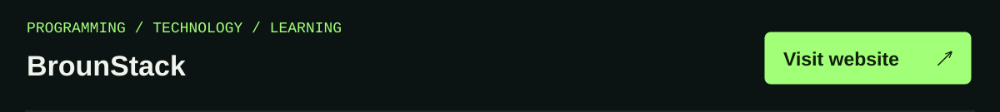
</picture>
</a>
<a href="https://www.indelvia.com/">
<picture>
  <source media="(max-width: 600px)" srcset="./assets/code-security/premium/action-indelvia-mobile.svg">
  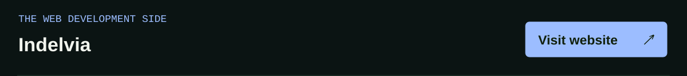
</picture>
</a>
<a href="https://www.linkedin.com/in/broun-v-a399332a9">
<picture>
  <source media="(max-width: 600px)" srcset="./assets/code-security/premium/action-linkedin-mobile.svg">
  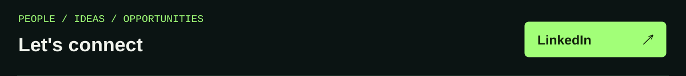
</picture>
</a>
<picture>
  <source media="(max-width: 600px)" srcset="./assets/code-security/premium/intro-mobile.svg">
  
</picture>
<picture>
  <source media="(prefers-reduced-motion: reduce) and (max-width: 600px)" srcset="./assets/code-security/code-interface-mobile-still.svg">
  <source media="(prefers-reduced-motion: reduce)" srcset="./assets/code-security/code-interface-still.svg">
  <source media="(max-width: 600px)" srcset="./assets/code-security/code-interface-mobile.svg">
  
</picture>
<picture>
  <source media="(max-width: 600px)" srcset="./assets/code-security/premium/section-security-mobile.svg">
  
</picture>
<a href="https://github.com/brounverma-tech/log-file-analyzer">
<picture>
  <source media="(max-width: 600px)" srcset="./assets/code-security/premium/log-analyzer-mobile.svg">
  
</picture>
</a>
<a href="https://github.com/brounverma-tech/file-integrity-checker">
<picture>
  <source media="(max-width: 600px)" srcset="./assets/code-security/premium/file-integrity-mobile.svg">
  
</picture>
</a>
<a href="https://github.com/brounverma-tech/network-port-scanner">
<picture>
  <source media="(max-width: 600px)" srcset="./assets/code-security/premium/port-scanner-mobile.svg">
  
</picture>
</a>
<a href="https://github.com/brounverma-tech?tab=repositories">
<picture>
  <source media="(max-width: 600px)" srcset="./assets/code-security/premium/action-repositories-mobile.svg">
  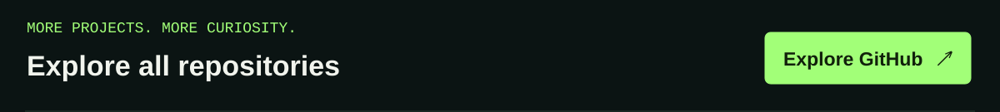
</picture>
</a>
<picture>
  <source media="(max-width: 600px)" srcset="./assets/code-security/premium/section-web-mobile.svg">
  
</picture>
<a href="https://brounstack.in/">
<picture>
  <source media="(max-width: 600px)" srcset="./assets/code-security/premium/brounstack-mobile.svg">
  
</picture>
</a>
<a href="https://www.indelvia.com/">
<picture>
  <source media="(max-width: 600px)" srcset="./assets/code-security/premium/indelvia-mobile.svg">
  
</picture>
</a>
<a href="https://brounverma-tech.github.io/modern-calculator/">
<picture>
  <source media="(max-width: 600px)" srcset="./assets/code-security/premium/calculator-mobile.svg">
  
</picture>
</a>
<a href="https://github.com/brounverma-tech/modern-calculator">
<picture>
  <source media="(max-width: 600px)" srcset="./assets/code-security/premium/action-source-mobile.svg">
  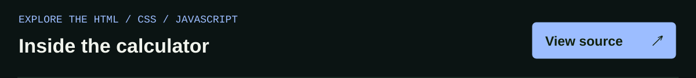
</picture>
</a>
<picture>
  <source media="(max-width: 600px)" srcset="./assets/code-security/premium/toolkit-mobile.svg">
  
</picture>
<picture>
  <source media="(max-width: 600px)" srcset="./assets/code-security/premium/focus-mobile.svg">
  
</picture>
<picture>
  <source media="(max-width: 600px)" srcset="./assets/code-security/premium/section-more-security-mobile.svg">
  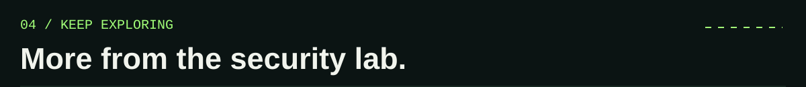
</picture>
<a href="https://github.com/brounverma-tech/password-strength-checker">
<picture>
  <source media="(max-width: 600px)" srcset="./assets/code-security/premium/resource-password-strength-checker-mobile.svg">
  
</picture>
</a>
<a href="https://github.com/brounverma-tech/secure-password-generator">
<picture>
  <source media="(max-width: 600px)" srcset="./assets/code-security/premium/resource-secure-password-generator-mobile.svg">
  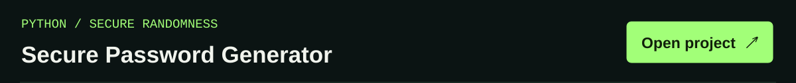
</picture>
</a>
<a href="https://github.com/brounverma-tech/linux-security-audit-tool">
<picture>
  <source media="(max-width: 600px)" srcset="./assets/code-security/premium/resource-linux-security-audit-tool-mobile.svg">
  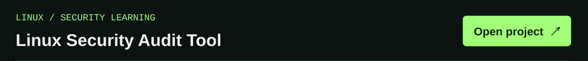
</picture>
</a>
<picture>
  <source media="(max-width: 600px)" srcset="./assets/code-security/premium/section-c-mobile.svg">
  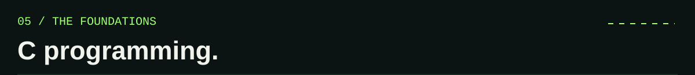
</picture>
<a href="https://github.com/brounverma-tech/c-student-grade-calculator">
<picture>
  <source media="(max-width: 600px)" srcset="./assets/code-security/premium/resource-c-student-grade-calculator-mobile.svg">
  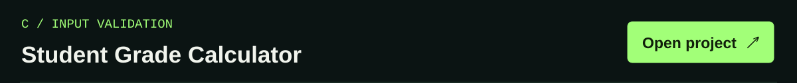
</picture>
</a>
<a href="https://github.com/brounverma-tech/c-number-guessing-game">
<picture>
  <source media="(max-width: 600px)" srcset="./assets/code-security/premium/resource-c-number-guessing-game-mobile.svg">
  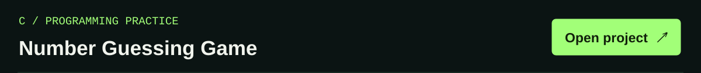
</picture>
</a>
<picture>
  <source media="(max-width: 600px)" srcset="./assets/code-security/premium/section-books-mobile.svg">
  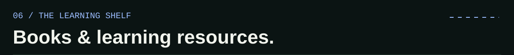
</picture>
<a href="https://github.com/brounverma-tech/web-technology-book">
<picture>
  <source media="(max-width: 600px)" srcset="./assets/code-security/premium/resource-web-technology-book-mobile.svg">
  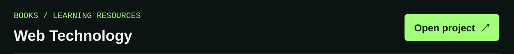
</picture>
</a>
<a href="https://github.com/brounverma-tech/problem-solving-with-programming-book">
<picture>
  <source media="(max-width: 600px)" srcset="./assets/code-security/premium/resource-problem-solving-with-programming-book-mobile.svg">
  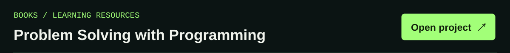
</picture>
</a>
<a href="https://github.com/brounverma-tech/mathematics-book">
<picture>
  <source media="(max-width: 600px)" srcset="./assets/code-security/premium/resource-mathematics-book-mobile.svg">
  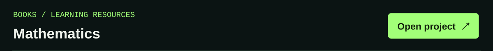
</picture>
</a>
<a href="https://github.com/brounverma-tech/functional-english-1-book">
<picture>
  <source media="(max-width: 600px)" srcset="./assets/code-security/premium/resource-functional-english-1-book-mobile.svg">
  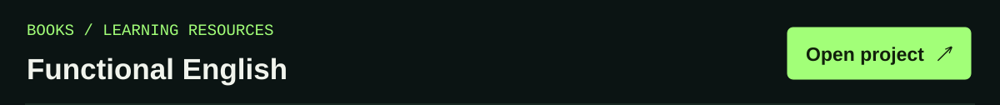
</picture>
</a>
<picture>
  <source media="(max-width: 600px)" srcset="./assets/code-security/premium/beyond-code-mobile.svg">
  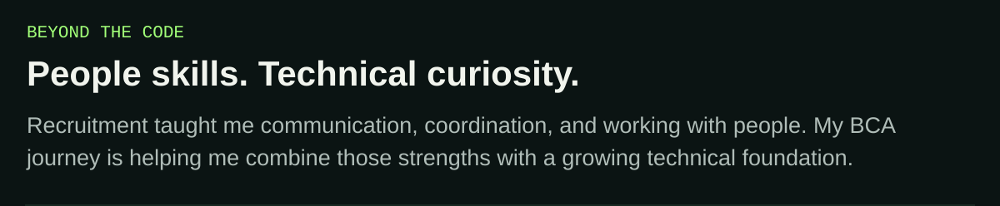
</picture>
<a href="https://github.com/brounverma-tech?tab=repositories">
<picture>
  <source media="(max-width: 600px)" srcset="./assets/code-security/premium/action-repositories-mobile.svg">
  
</picture>
</a>
<a href="https://www.linkedin.com/in/broun-v-a399332a9">
<picture>
  <source media="(max-width: 600px)" srcset="./assets/code-security/premium/action-linkedin-mobile.svg">
  
</picture>
</a>

