<picture>
  <source media="(prefers-reduced-motion: reduce) and (max-width: 600px)" srcset="./assets/code-security/hero-mobile-still.png">
  <source media="(prefers-reduced-motion: reduce)" srcset="./assets/code-security/hero-still.png">
  <source media="(max-width: 600px)" srcset="./assets/code-security/hero-mobile.gif">
  
</picture>

  <a href="https://brounstack.in/">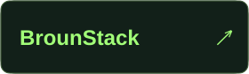</a>
  <a href="https://www.indelvia.com/">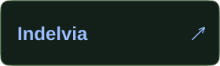</a>
  <a href="https://www.linkedin.com/in/broun-v-a399332a9">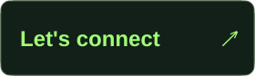</a>

<picture>
  <source media="(max-width: 600px)" srcset="./assets/code-security/premium/intro-mobile.svg">
  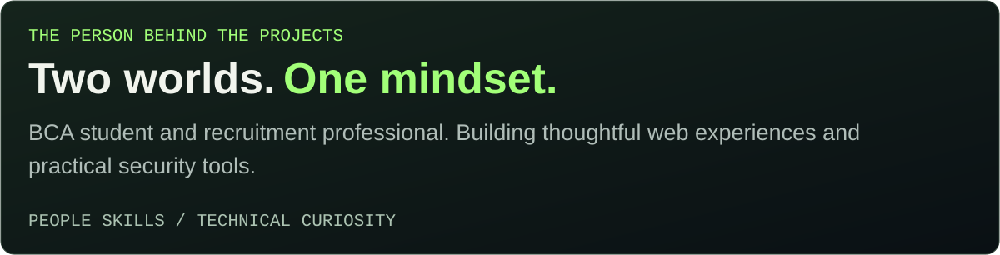
</picture>

<picture>
  <source media="(prefers-reduced-motion: reduce) and (max-width: 600px)" srcset="./assets/code-security/code-interface-mobile-still.svg">
  <source media="(prefers-reduced-motion: reduce)" srcset="./assets/code-security/code-interface-still.svg">
  <source media="(max-width: 600px)" srcset="./assets/code-security/code-interface-mobile.svg">
  
</picture>

<picture>
  <source media="(max-width: 600px)" srcset="./assets/code-security/premium/section-security-mobile.svg">
  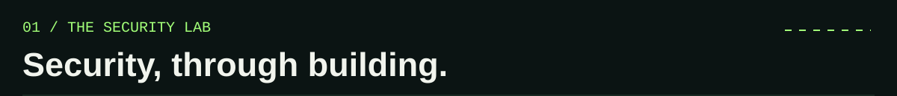
</picture>

<a href="https://github.com/brounverma-tech/log-file-analyzer">
<picture>
  <source media="(max-width: 600px)" srcset="./assets/code-security/premium/log-analyzer-mobile.svg">
  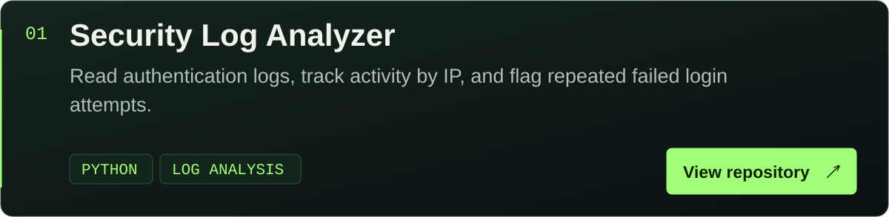
</picture>
</a>

<a href="https://github.com/brounverma-tech/file-integrity-checker">
<picture>
  <source media="(max-width: 600px)" srcset="./assets/code-security/premium/file-integrity-mobile.svg">
  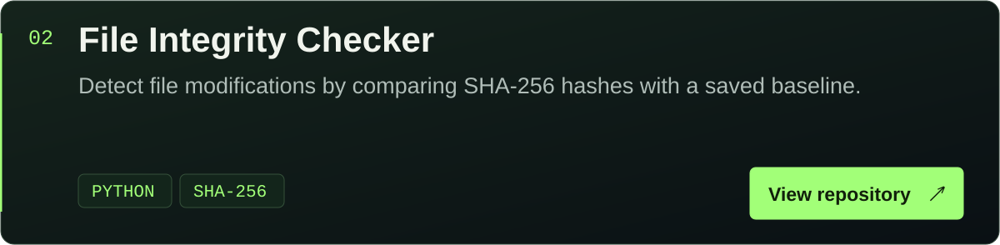
</picture>
</a>

<a href="https://github.com/brounverma-tech/network-port-scanner">
<picture>
  <source media="(max-width: 600px)" srcset="./assets/code-security/premium/port-scanner-mobile.svg">
  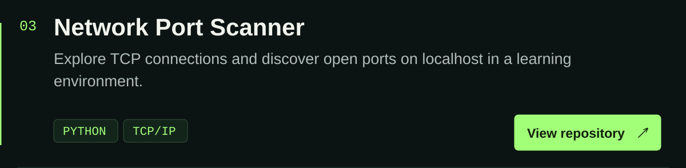
</picture>
</a>

  <a href="https://github.com/brounverma-tech?tab=repositories">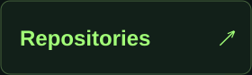</a>

<picture>
  <source media="(max-width: 600px)" srcset="./assets/code-security/premium/section-web-mobile.svg">
  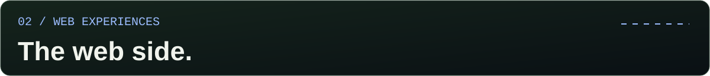
</picture>

<a href="https://brounstack.in/">
<picture>
  <source media="(max-width: 600px)" srcset="./assets/code-security/premium/brounstack-mobile.svg">
  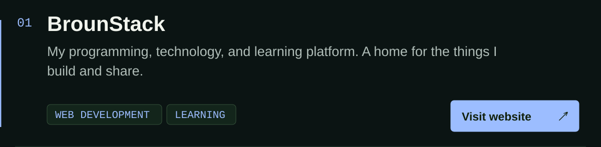
</picture>
</a>

<a href="https://www.indelvia.com/">
<picture>
  <source media="(max-width: 600px)" srcset="./assets/code-security/premium/indelvia-mobile.svg">
  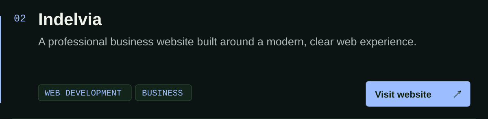
</picture>
</a>

<a href="https://brounverma-tech.github.io/modern-calculator/">
<picture>
  <source media="(max-width: 600px)" srcset="./assets/code-security/premium/calculator-mobile.svg">
  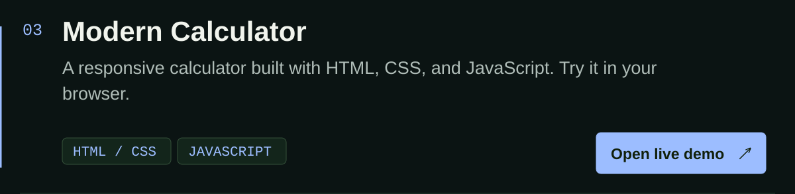
</picture>
</a>

  <a href="https://github.com/brounverma-tech/modern-calculator">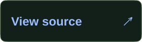</a>

<picture>
  <source media="(max-width: 600px)" srcset="./assets/code-security/premium/toolkit-mobile.svg">
  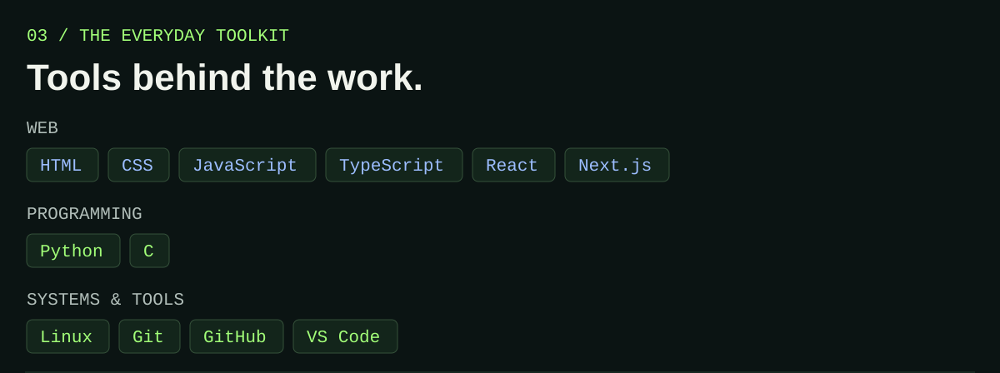
</picture>

<picture>
  <source media="(max-width: 600px)" srcset="./assets/code-security/premium/focus-mobile.svg">
  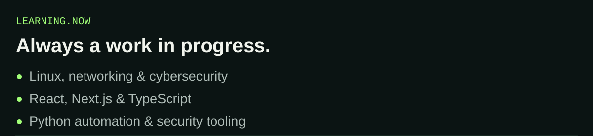
</picture>

<b>Explore more of my learning journey</b>

#### More from the security lab

[Password Strength Checker](https://github.com/brounverma-tech/password-strength-checker) · [Secure Password Generator](https://github.com/brounverma-tech/secure-password-generator) · [Linux Security Audit Tool](https://github.com/brounverma-tech/linux-security-audit-tool)

#### C programming

[Student Grade Calculator](https://github.com/brounverma-tech/c-student-grade-calculator) · [Number Guessing Game](https://github.com/brounverma-tech/c-number-guessing-game)

#### Books & learning resources

[Web Technology](https://github.com/brounverma-tech/web-technology-book) · [Problem Solving with Programming](https://github.com/brounverma-tech/problem-solving-with-programming-book) · [Mathematics](https://github.com/brounverma-tech/mathematics-book) · [Functional English](https://github.com/brounverma-tech/functional-english-1-book)

#### Beyond the code

Recruitment taught me communication, coordination, and working with people. My BCA journey is helping me combine those strengths with a growing technical foundation.

  
  

